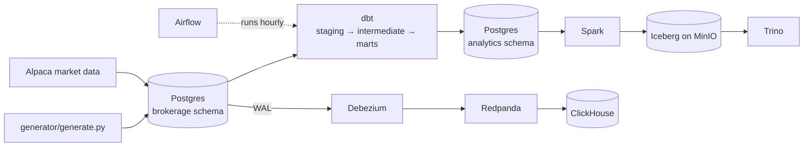

# trade-ledger-analytics

A small brokerage data platform I built to practise the parts of analytics engineering that don't show up in dashboard work: modelling messy financial event data, contracts and freshness checks, incremental loads, open table formats, and change data capture.

The setup is a pretend retail brokerage. A Postgres database plays the role of the trading system (accounts, orders, executions, cash movements), a Python script keeps it busy, and daily prices come from Alpaca's market data API. From there the data goes three ways:

- **batch**: dbt builds tested, contracted models; Airflow runs it hourly; GitHub Actions runs it on every PR
- **lakehouse**: Spark copies trade history into Iceberg tables on MinIO, and Trino queries them
- **streaming**: Debezium reads the Postgres WAL, pushes changes through Redpanda, and ClickHouse keeps a live view



## Why a brokerage

Most of my work has been on payments and lending data, where the hard part is never the SQL. It's that the same transaction shows up twice, a reversal lands in a different period from the original, and two teams get different totals from the "same" table. Trading data has all of that and a bit more, so the generator deliberately produces:

- **duplicate execution reports**: the same `exec_id` delivered twice with different `fill_id`s, like a venue retrying
- **late fills**: executions that reach us one to three days after they happened
- **reversals**: busted trades that come in later as their own rows
- **orders that stay open** and get filled or cancelled on a later run (this is what makes the CDC stream interesting)

## The dbt project

```
transform/models
├── staging        one model per source table, renamed and typed; fills deduplicated on exec_id
├── intermediate   executions with order context and signed quantities; per-order fill summary
└── marts          fct_trades, fct_orders, fct_cash_ledger, fct_daily_positions, dim_accounts
```

A few decisions worth explaining:

**`fct_trades` is incremental on `ingested_at`, not `executed_at`.** A fill that executed on Monday but only reached us on Wednesday is still new as far as Wednesday's run is concerned. Filtering on execution time would miss it forever. There's a small lookback (`trades_lookback_hours`) for clock skew and a test that fails if anything is stamped in the future, because one bad timestamp would stop every later incremental run from picking up rows. I found that one the hard way while building the generator.

**Reversals are rows, not updates.** A busted trade gets its own row with a negative `signed_qty`. History never gets rewritten, positions still net out, and you can always see what was reversed and when.

**Duplicates are counted, not just dropped.** `stg_brokerage__fills` keeps the first report per `exec_id` and records how many extras it threw away (`duplicate_reports_dropped`). If that number jumps one day, it usually means the upstream connection is unstable, and someone should know.

**Every mart has an enforced contract.** Column names and types are declared in `_marts.yml`. If someone renames or retypes something upstream, `dbt build` fails at the mart instead of a dashboard breaking a week later. `fct_trades` also has a primary key constraint on `exec_id`.

**Account history is a snapshot.** Tier and status are overwritten in the source, so `snap_accounts` (SCD Type 2) is the only place that can answer "what tier was this customer on when they placed that trade?"

### Tests

Generic tests on keys, relationships and accepted values, plus a few that encode the actual money rules:

| test | what it catches |
| --- | --- |
| `assert_trade_cash_reconciles` | every execution has exactly one cash settlement, for the right amount |
| `assert_fills_never_exceed_order_qty` | duplicate reports leaking past staging |
| `assert_no_short_positions` | a sell without its buy, or a reversal applied twice |
| `assert_no_future_ingestion` | the timestamp problem described above |
| unit test on `stg_brokerage__fills` | the dedupe logic, with three hand-written rows |

### Freshness SLAs

Defined in `_brokerage__sources.yml`:

| source | warn | error |
| --- | --- | --- |
| orders, fills, cash movements | 1 hour | 6 hours |
| market prices | 36 hours | 96 hours (covers weekends) |

In Airflow, `dbt source freshness` runs before anything is built. If the feed is more than 6 hours behind, the run stops there rather than rebuilding marts on stale data.

## Running it

You need Docker (give it at least 8 GB of memory if you want the lakehouse or CDC profiles) and Python 3.11.

```bash
cp .env.example .env              # add Alpaca paper-trading keys, or leave blank for synthetic prices
python -m venv .venv && source .venv/bin/activate
pip install -r requirements.txt

make up                           # postgres + airflow
make seed                         # ~120 days of history
make dbt                          # freshness check, then build + test everything
make docs                         # dbt docs and lineage graph on localhost:8085
```

Airflow is on [localhost:8080](http://localhost:8080). It runs in standalone mode; the admin password is printed in the container logs (`docker compose logs airflow | grep password`). Turn on the `brokerage_pipeline` DAG and it will add new activity and rebuild every hour.

### Lakehouse

```bash
make lakehouse                    # minio, iceberg REST catalog, spark, trino
make iceberg                      # copy fct_trades into two Iceberg tables
make trino-pruning                # same query on partitioned vs unpartitioned
```

`lakehouse/queries/02_iceberg_features.sql` walks through snapshots, schema evolution, time travel and compaction in Trino. My notes on what the query plans showed are in [docs/lakehouse-notes.md](docs/lakehouse-notes.md).

### CDC

```bash
make cdc                          # redpanda, debezium, clickhouse
make clickhouse                   # create the kafka tables, materialized views and live views
make connector                    # register the debezium postgres connector
make tick                         # generate some activity, then:
make rt                           # today's volume per symbol, from clickhouse
```

The ClickHouse side uses `ReplacingMergeTree` keyed on the source primary key, with the source commit time as the version, so each order collapses to its latest state. Deletes come through Debezium as `__deleted = 'true'` and are handled by the engine's `is_deleted` column.

When to use this path and when the hourly batch is enough is written up in [docs/cdc-vs-batch.md](docs/cdc-vs-batch.md).

## Repo layout

```
generator/        fake trading activity (seed + tick modes)
ingestion/        Alpaca daily bars -> raw.market_prices
sql/init/         source schema, created when postgres first starts
transform/        the dbt project
orchestration/    Airflow image and DAG
lakehouse/        spark job, trino catalog, queries
cdc/              debezium connector config, clickhouse DDL
docs/             write-ups
```

## Things I'd do next

- Version `fct_trades` (dbt model versions) to show how I'd roll out a breaking contract change without breaking consumers
- Run the same dbt models on Trino with `dbt-trino`, so the lakehouse isn't just a copy
- Corporate actions: splits would change position quantities and need their own handling
- Slim CI (`state:modified+`) once there are enough models for it to matter
- Real alerting instead of the log line in the DAG's failure callback
